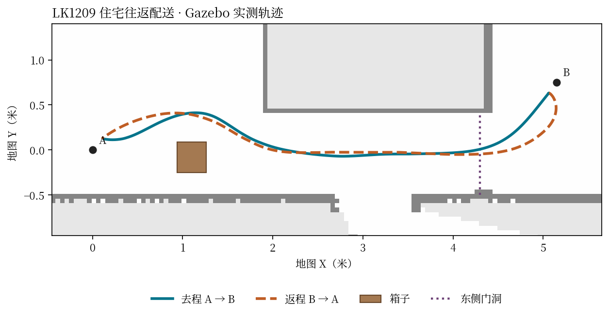

# LK1209 住宅配送仿真

LK1209 在 Gazebo Harmonic 的 TurtleBot3 House 中运行。SLAM Toolbox 用于建图，AMCL 在保存的地图上定位，Nav2 执行导航。单车和双车配送共用 ROS 2 Action `/delivery_task`。



| 导航配置 | 全局规划 | 局部控制 |
| --- | --- | --- |
| `classic`（默认） | NavFn，启用 A* | DWB |
| `smac_rpp` | Smac 2D | Regulated Pure Pursuit |
| `lk_astar` | 本项目实现的四邻域 A* | DWB |

经典配置下，建图时 SLAM Toolbox 用里程计提供的初始位姿匹配激光扫描，识别回环后优化轨迹并生成二维地图。加载保存的地图后，AMCL 估计车身位姿。雷达回波更新代价地图，A* 搜索通往目标的路径，DWB 在局部代价地图上预测候选速度对应的轨迹，底盘前的方向保护和碰撞监控再检查最终速度。

## 运行环境

已使用 Ubuntu 22.04、ROS 2 Humble 和 Jetson Orin Nano。需要 Humble 的 Nav2、Collision Monitor、SLAM Toolbox、Xacro、colcon、Gazebo Harmonic、与 Harmonic 匹配的 `ros_gz_bridge` / `ros_gz_sim`，以及 Gazebo Transport 13 和 Msgs 10 的系统 Python 绑定。以下命令从仓库根目录运行。Jetson 的桥接工作空间默认在 `~/ros_gz_harmonic_ws`。

ROS 启动脚本使用系统 Python 的 PyYAML，3D 雷达验收还使用 NumPy。单车可通过 `HARMONIC_WS` 指定桥接工作空间，双车可通过 `ROS_GZ_WS` 指定。启动脚本会用 colcon 编译本仓库的依赖包。

## 启动仿真

双车在同一住宅内出生。默认只开服务器，桌面上需要 Gazebo 窗口时加 `--gui`。

```bash
bash simulation/fleet.sh
```

导航配置可以从启动命令切换。要用 Smac 2D 的代价感知 A* 和 Regulated Pure Pursuit（RPP），启动时执行：

```bash
bash simulation/fleet.sh --nav-profile smac_rpp
```

单车导航也支持 `--nav-profile smac_rpp`。该配置需要对应的 Humble 插件包 `ros-humble-nav2-smac-planner` 和 `ros-humble-nav2-regulated-pure-pursuit-controller`。Smac 负责在代价地图上选路，RPP 沿路径计算速度、在弯道限速并向前投影检查碰撞。仿真底盘保留原有的速度保护和 Collision Monitor。

单车可以分别启动建图或已存地图导航。每次选择一个模式。

```bash
bash simulation/start_robot.sh slam --world turtlebot3_house
# 或使用已有住宅地图
bash simulation/start_robot.sh navigation "$PWD/ros2_ws/src/robot_navigation/maps/turtlebot3_house_test.yaml" --world turtlebot3_house
```

在另一个终端加载工作空间。

```bash
source /opt/ros/humble/setup.bash
source ros2_ws/install/setup.bash
ros2 action list -t
```

### 自研四邻域 A*

```bash
bash simulation/start_robot.sh navigation "$PWD/ros2_ws/src/robot_navigation/maps/turtlebot3_house_test.yaml" --world turtlebot3_house --nav-profile lk_astar
```

在已加载工作空间的终端运行 `ros2 param get /planner_server GridBased.plugin`，应显示 `lk1209_astar_planner/FourNeighborAStar`。在 RViz 选择 Nav2 Goal 可指定东侧房间的地图坐标 `(5.15, 0.75)`。双车入口也可传 `--nav-profile lk_astar`。

规划器复制当前全局代价地图，从起点向上下左右四个相邻格搜索。进入一个可通行格的代价是 `1 + cost_weight × 栅格代价 / 252`，默认 `cost_weight = 4`。内切膨胀、致命障碍和未知格均禁止通行。启发函数为距目标的曼哈顿距离。无路时插件向 Nav2 报告规划失败，让导航行为树处理。算法与 ROS 适配分别位于[搜索实现](ros2_ws/src/lk1209_astar_planner/src/grid.cpp)和[规划器插件](ros2_ws/src/lk1209_astar_planner/src/planner.cpp)。

2026-11-24，在 Jetson 上用二维雷达单车实测上述东侧目标。Nav2 加载了自研 A* 和 DWB，Gazebo 记录到车辆由西向东穿过门洞。27.951 个仿真秒后，`NavigateToPose` 返回 `SUCCEEDED`。按 Gazebo 世界位姿计算，终点误差为 0.185 m。此轮测试共采集 538 个位姿样本。[穿门验收数据](docs/astar-door-acceptance.json)

建图后可另开终端执行 `bash simulation/save_map.sh my_house`，生成的 YAML 与 PGM 保存在 `ros2_ws/src/robot_navigation/maps/`。

### 单车 16 线激光雷达

在 Jetson 项目根目录运行：

```bash
bash simulation/start_robot.sh navigation "$PWD/ros2_ws/src/robot_navigation/maps/turtlebot3_house_test.yaml" --world turtlebot3_house --nav-profile smac_rpp --lidar 3d
```

Gazebo 在每个水平角度发射 16 束不同仰角的激光，水平采样 360 个方位，仰角为 −20° 至 +10°。RViz 中的 `/lidar/points` 显示原始点云，`/lidar/obstacles` 显示按车身高度筛选后的障碍点。水平一层生成 `/scan` 供 AMCL 使用。建图时可运行 `bash simulation/start_robot.sh slam --world turtlebot3_house --lidar 3d`，由 SLAM Toolbox 建立二维占用地图。

处理节点根据 Harmonic OGRE2 采样的实际方向计算下视射线的落点高度，在 `base_footprint` 中用 RANSAC 识别室内地板，再用 2 cm 体素合并重复障碍点。浅角度射线对高度误差很敏感，这个投影校正只适用于当前 360 × 16 的仿真传感器。位于底盘顶面的自车回波按遮挡处理。LK1209 在模型中的最高碰撞面约为 20 cm，导航保留至 22 cm 的障碍点。局部和全局代价地图按可见射线逐体素清除障碍物移走后露出的空间。

住宅单车从出生点启动并完成定位后，可依次运行以下命令。结果目录中需使用新的文件名。第一项检查实际点云、障碍点、二维扫描和局部代价地图。第二项会发送 Nav2 目标，记录机器人绕过低横杆、穿过高横杆下方、绕过矮箱和回到起点的轨迹指标。

```bash
source /opt/ros/humble/setup.bash
source ros2_ws/install/setup.bash
run_dir=$(mktemp -d -p simulation/logs lidar3d-XXXXXXXX)
/usr/bin/python3 simulation/test_3d_lidar.py "$run_dir/perception.json"
/usr/bin/python3 simulation/test_3d_lidar_navigation.py "$run_dir/navigation.json"
```

## 下单与撤单

把 `robot_id` 留空即可自动分配车辆。状态按 `QUEUED → OUTBOUND → DWELL → RETURNING` 变化；反馈还包括车名和 Nav2 报告的剩余米数。到站默认停留 3 秒，回到该车自己的起点后才返回成功。单车使用 `lk1209`，双车使用 `robot1` 和 `robot2`。

```bash
ros2 action send_goal /delivery_task lk1209_interfaces/action/DeliveryTask \
  "{station: east_room, robot_id: ''}" --feedback
```

双车有东、西两个配送站。可在另一终端给第二辆车下达另一笔订单。在这座住宅里，去程和返程共享窄门，调度器为整段往返保留通行权，排队车辆在起点等待。车辆各自使用 `/<车名>/scan`、`odom`、`tf`、`tf_static` 和 `navigate_to_pose`，同用住宅地图坐标和仿真时钟。

客户端持有订单目标句柄后可调用 `cancel_goal_async()`。调度器按该单对应的 Nav2 目标 UUID 请求取消。途中停车后会为原车保留路线；确认车停稳后，给该车下回库单，回库成功才放行其他车辆。例如：

```bash
ros2 action send_goal /delivery_task lk1209_interfaces/action/DeliveryTask \
  "{station: home, robot_id: robot2}" --feedback
```

共用路线的占用状态保存在调度进程中。运行中的配送统一通过 `/delivery_task` 下达。异常退出后应从两车起点冷启动这一仿真，再继续派单。

## 双车验收

在刚启动且两车停靠各自起点的双车仿真中执行：

```bash
/usr/bin/python3 simulation/test_fleet_delivery.py --case fleet
```

第一单实际穿过门洞，到东站后原路回库。第二单在第一单执行期间提交，轮到它后，用其自己的目标句柄撤单。脚本核对 Gazebo 世界位姿、门洞穿越方向、排队位移、停车以及 Nav2 终态，失败时退出码非零。双车站点与回库姿态见 `ros2_ws/src/robot_navigation/config/fleet_delivery.yaml`。单车可用 `--case single` 或 `--case cancel`。

### 雷达和固定障碍验收

每辆车的 C++ 节点从自己的 `scan` 接收数据。无效或超量程的扫描束会切断点组，相邻有效回波经分组、分裂合并和直线拟合，输出的 `obstacle_segments` 保留原始帧和时间戳。`obstacle_points` 仅包含实测且距所属拟合线段不超过 2.5 厘米的点。双车的话题分别位于 `/robot1` 和 `/robot2`。

`smac_rpp` 的局部和全局代价地图用该点云补充标记，原始激光同时负责障碍标记和射线清除。未形成线段的细小物体仍走原始扫描通道。两辆车从起点启动后可执行：

```bash
/usr/bin/python3 simulation/test_lidar_segments.py --frames 12 --timeout 90
/usr/bin/python3 simulation/test_fleet_delivery.py --case fleet --static-obstacle
```

第二条命令在直达路线放一个固定箱，读取运行中的插件和代价栅格，记录往返净距及门洞轨迹，然后按模型标识清理该箱。测试撤单后的回库方式见上文。

2026-11-20 在 Jetson 上运行上述固定箱场景，Smac 2D＋RPP 的去程与返程均穿门成功。1,543 个 Gazebo 位姿样本的车体至箱子平面净距下界最小为 0.11235 m；排队车位移为 0 m，撤单和回库均成功。完整数据含经典组合的配送对照和逐车雷达测量，见[住宅双车验收记录](docs/house-fleet-acceptance.json)。

### 门前移动推车验收

启动 `bash simulation/fleet.sh --nav-profile smac_rpp`，等两车在各自起点停稳、没有活动订单后，在已加载工作空间的另一终端运行。每轮使用新的结果目录。

```bash
/usr/bin/python3 simulation/test_moving_cart.py "simulation/logs/door-cart-$(date +%Y%m%d-%H%M%S)"
```

一号车向东站配送时，推车以 0.32 m/s 横穿门前通道，在中线停留至少 3 个仿真秒后移出。二号车保留一笔排队单，一号车返程穿门后撤销该单。脚本记录实际往返和撤单结果，并清理本次创建的推车。

查看结果目录中的 `order.json` 核对订单与两次穿门，`motion.json` 核对全程采样到的最小外包络净距、二号车排队位移和清道后的恢复时间。恢复通行要求一号车连续 0.5 仿真秒向东前进，每个 0.1 秒窗口速度均超过 0.04 m/s。`sensor_summary.json` 提供同一时段的雷达、代价地图和速度指令记录。

本轮在 Jetson 的 TurtleBot3 House 中验证通过。推车横穿期间最近净距 24.8 cm，全程最近 10.8 cm，二号车排队期间位移为 0 m。推车让出通道后，一号车先缓行，10.25 个仿真秒后达到上述持续前进判据。[实测验收数据](docs/door-cart-acceptance.json)

每轮总结果写入 `acceptance.json`。保留原始记录后，可用 `/usr/bin/python3 simulation/test_moving_cart.py --assess-only <结果目录>` 复核订单、位姿、雷达和代价地图。

#### 推车折返与二次刹停

两车在起点停稳后，用 `--reenter` 发起同一配送任务。推车先照常横穿并停到南侧。等里程计确认一号车已经停过、又以超过 0.015 m/s 的速度向前行驶至少 0.20 个仿真秒，且前向停车区已清空，推车再以 0.32 m/s 向北折返。

```bash
/usr/bin/python3 simulation/test_moving_cart.py --reenter "simulation/logs/door-cart-reentry-$(date +%Y%m%d-%H%M%S)"
```

在 `reentry.json` 中查看折返期间的最小轮廓净距、停车指令和实际刹停时间。两项时间分别以推车开始折返、第一帧有至少 3 束推车回波进入停车区为基准。相对入区时间为负表示车辆提前制动。实际刹停需由里程计连续 0.30 个仿真秒确认。订单返回、往返穿门、全程净距和折返检查均通过时，`acceptance.json` 才会给出 `passed: true`。

2026-11-21 的 Jetson 实测中，从首帧检测到折返推车进入停车区起，底盘在 0.031 个仿真秒后收到零速指令，里程计在 0.049 秒后记录到停车。折返阶段最近净距为 20.9 cm，全程最近净距为 14.7 cm。一号车完成原订单并回库。[折返验收数据](docs/door-cart-reentry-acceptance.json)

## 场景来源

住宅模型来自 ROBOTIS 的 TurtleBot3 Simulations。上游版本、场景适配及所用资源的许可证见 [场景来源](simulation/vendor/turtlebot3_house/SOURCE.md) 和[许可证](simulation/vendor/turtlebot3_house/LICENSE)。
